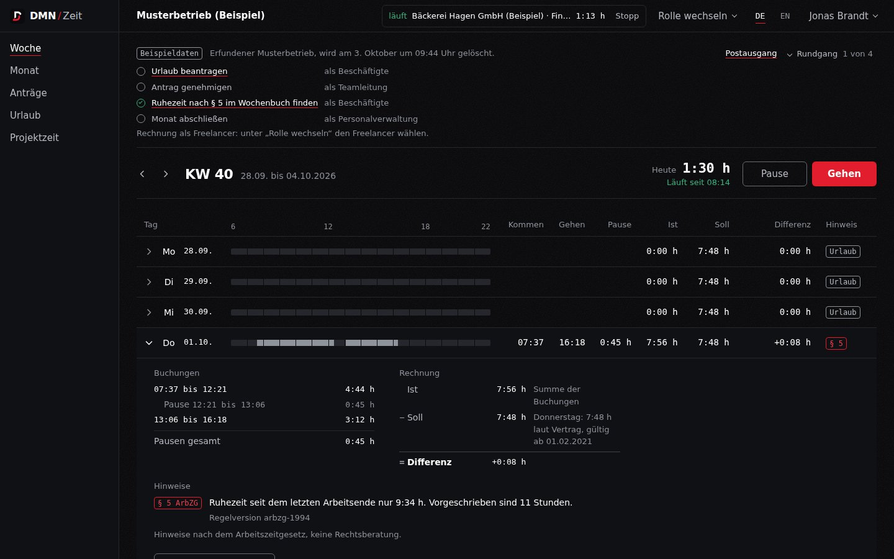

[Deutsche Fassung](README.de.md)

# dmn-zeit

Working time, leave and flextime under German labour law (ArbZG, BUrlG) for small businesses, plus project time and invoices under § 14 UStG with e-invoicing, where every figure shows what it is made of.



---

## Try it

**Demo: [zeit-demo.dmn-software.com](https://zeit-demo.dmn-software.com)**

No account, no password. Click **"Start demo"** on the start page (the interface switches between German and English at the top). That creates a sandbox of your own: a made-up sample company (a tax office in North Rhine-Westphalia, twelve people in three teams, bookings since January, open requests, findings under the Working Hours Act) and, next to it, the solo workspace of a made-up freelancer with clients, projects and invoices. The demo opens in the employee role; **"Switch role"** leads on to team lead, HR, administration and the solo workspace, without a password.

What is different in the demo:

- The sandbox is deleted after 24 hours, together with everything entered. The cleanup job runs every 15 minutes.
- E-mails do not go out, they land in the **Outbox** (link in the banner at the top).
- Invoices carry the watermark "Specimen invoice – not an invoice within the meaning of § 14 UStG" (on English invoices next to the German line) and a number starting with `MUSTER-`. This depends on the tenant kind `sandbox`, not on a configuration switch.
- Issuing and cancelling otherwise require a fresh confirmation with password and second factor (step-up). The demo skips it, because there are no passwords there.

So the demo cannot be drained, sandboxes are rationed: three per hour and ten per day from one address (IPv6 per /64), at most 300 at the same time. Past that the start page says "Too many demos were started from this connection in a short time." or "The demo is full right now." and shows how long to wait. Each sandbox also has row limits per table, for example 20,000 bookings or 2,000 invoice lines.

The live instance `zeit.dmn-software.com` is invitation-only. There is no open sign-up, the operator creates companies and solo workspaces through the CLI, and a second factor (passkey or TOTP) is mandatory for every role.

### The core idea in two minutes

1. **"Start demo".** The week view of a person in the employee role opens; they clocked in this morning. At the top **Start break** and **Clock out**, above that the tour with four steps in the company and one in the solo workspace.
2. **Expand a day with a red `§ 5`** (tour step "Find the § 5 rest period in the week"). On the left the bookings with breaks, on the right actual minus target together with the contract the target comes from, below it the finding "Rest period since the last shift only … 11 hours are required." with the rule version. Times are random per sandbox.
3. **Requests → "New request"**, choose leave and a period, **"Submit request"**.
4. **"Switch role" → team lead**, in the **Inbox** click **"Approve"**. The leave account books the days.
5. **"Switch role" → HR**, open last month under **HR → Month-end close**. The checklist shows what blocks (open requests, a booking without clock-out) and what is only a notice, plus the flextime the close will book as a cap. After **"Close month"**, bookings, requests and contracts up to the end of that month are locked.
6. **"Switch role" → Freelancer.** The start page is the week matrix project × day, a project timer is running. Below it **"Unbilled"** with amounts per client.
7. **Invoices**, open the draft for the agency. The **Preview** is a real PDF from the same renderer as the original later on. **"Issue"**, format ZUGFeRD, **"Issue now"**: the invoice gets the next number and cannot be changed afterwards.
8. **"Download PDF"** returns a PDF/A-3 with the XML embedded. An invoice to the municipal utility was issued as XRechnung; there you also get **"Download XML"**.
9. **"Cancel invoice"** with a reason (at least ten characters) → **"Issue cancellation invoice"**. The cancellation invoice gets its own number, and both invoices point to each other.

Also worth a look: the mail in the **Outbox** that an HR correction triggers, and in the solo workspace, switch the tax profile to small business (Kleinunternehmer) under **"Invoicing profile"**. The open draft then reports the changed tax profile; after **"Reload booked time"** its preview shows the § 19 note, and the revenue check works out why last year's revenue rules the exemption out.

---

## What is in it

- **Time clock and week view** with a day bar; clocking out during a break ends the day where the break began. Shifts across midnight and 23- or 25-hour days at the clock change come out right.
- **Checks under the ArbZG** as notices, not as locks: § 3 (more than 8 and more than 10 hours), § 4 (total break, only breaks of 15 minutes or more count; more than 6 hours in a row), § 5 (rest period under 11 hours), § 9 (Sundays and public holidays). Rules are versioned, a reform becomes a new entry.
- **Corrections only as a request with a reason.** Nobody approves their own. HR corrects other people's times immediately, with a mandatory reason, an audit entry and a mail to the person.
- **Leave under the BUrlG:** waiting period, partial leave and pro-rating by twelfths, statutory minimum, carry-over until 31 March, expiry only after a documented notice (BAG 9 AZR 541/15), refund for sickness during leave only after the doctor's note is confirmed.
- **Flextime account** with a cap per contract or company, time off in lieu as an absence type, team calendar.
- **Public holidays of all 16 federal states** with the years they apply, e.g. Women's Day in Berlin from 2019.
- **Month-end close** with checklist, snapshot and lock, then timesheet and monthly overview as CSV.
- **Project time** with a timer of its own next to the time clock, entries after the fact with a mandatory note, week matrix project × day. Rates with a valid-from date per client, project, task or person, rounding per project, task and day, budget with warning.
- **Solo workspace** for freelancers: a tenant kind of its own with exactly one person, without time clock, leave and HR.
- **Invoices under § 14 UStG** from recorded time plus free lines, PDF laid out per DIN 5008. Standard taxation, small business under § 19, reverse charge for EU businesses, third countries, small-amount invoices up to €250. Mandatory details are checked before the number, invoice language German or English per client, payment status, deletion protection during the retention period.
- **E-invoicing:** XRechnung (CII) and ZUGFeRD EN 16931 as PDF/A-3. Default per client, the XML is stored as the original.
- **Time report** per client and period or per invoice, as PDF or CSV.
- **Sign-in** without third parties: argon2id with pepper, passkeys, TOTP, recovery codes, step-up for sensitive actions.
- **Interface in German and English** with the same content, domain terms with fixed translations (`docs/glossary.md`).

## What is deliberately not in it

- **GPS, hardware terminals, shift planning.** The target group are offices, service businesses and administrations with flextime who clock in from the browser or a phone.
- **AI features.** Left out on purpose. The domain logic is deterministic code, every rule is listed with its section and source in `docs/rules.md`.
- **Automatic break deduction.** What is booked is what was clocked. If a break is missing, the § 4 notice appears.
- **Exceptions under §§ 10–11 ArbZG** (healthcare, hospitality, emergency services). Work on Sundays and holidays therefore always produces a warning.
- **Expiry during long-term sickness** (15-month period). The interface names the limit, version 1 does not calculate it.
- **Dunning, multiple currencies, template editor, incoming invoices.** Not in version 1. All amounts are euros in whole cents.
- **Domestic reverse charge under § 13b(2) UStG and OSS.** The software treats such sales as regularly taxable in Germany. Whether the target group has them is an open question for the tax adviser in `docs/rechnungen-recht.md`.
- **Time report attached to the e-invoice.** With the attachment, rendering would break the 5 s limit of the worker, and the library also writes attachments into the XML as Base64. The report is rendered on each request from the frozen assignment instead.
- **DATEV export.** A later extension.

---

## Architecture

```
Browser
  │
  ▼
zeit-web   Caddy, static SPA, CSP, zstd/gzip except /api
  │  /api/*
  ▼
zeit-api   NestJS
  │   Guards: throttler → session → CSRF → 2FA enrolment → workspace → role → step-up
  │   Modules: time, corrections, absences, vacation, flex, compliance, months, exports,
  │            projects, billing, invoices, documents, demo, auth, org
  │
  ├── withTenant(session, trx => …)
  │     set_config('app.tenant_id' …, true) per transaction
  │           ▼
  │     PostgreSQL 17
  │       zeit_app     runtime role, NOBYPASSRLS, DML only
  │       RLS          ENABLE + FORCE, restrictive per tenant
  │       triggers     append-only journals, month lock, audit.track()
  │       zeit_system  SECURITY DEFINER, search_path = ''
  │                    (sign-in, number assignment, sandbox purge)
  │
  ├── worker_threads   pdfkit, @e-invoice-eu/core
  │                    5 s, 128 MB, 2 at once, 10 queued
  │
  └── mail             Resend (live) | outbox (demo)

packages/rules      domain logic without I/O and without a clock, "now" is a parameter
packages/shared     zod contracts for API and SPA
packages/demo-data  deterministic generator for sample company and solo world
```

The SPA computes previews with the same functions from `@zeit/rules`; the server stays authoritative. A large part of the rules lives in PostgreSQL itself: an `EXCLUDE USING gist` over `tstzrange` prevents overlaps, journals reject changes, a trigger locks closed months. The API maps database error codes directly (`23P01` → `TIME_OVERLAP`, `ZT001` → `PERIOD_LOCKED`). Hence Kysely instead of an ORM: policies, constraints and triggers cannot be fully described in any ORM schema, there would be two sources (ADR 0001).

**Stack:** Node.js 24, pnpm workspace, NestJS 11, Kysely with `pg`, dbmate, PostgreSQL 17, zod, `@node-rs/argon2`, `@simplewebauthn/server`, pdfkit, `@e-invoice-eu/core`, Vite 8, React 19, TanStack Router and Query, React Aria Components, i18next, CSS Modules, Vitest, Testcontainers, Playwright.

---

## Decisions

### 1. Invoice numbers from a counter table, not from a sequence

An invoice number must be sequential and unique. A PostgreSQL sequence does not fit: `nextval` is not transactional, every rollback leaves a gap.

Numbers are therefore assigned only inside the definer function `app.issue_invoice`, through an upsert on `app.invoice_counters (tenant_id, year, last_seq)`. The upsert locks the row until commit, including for the first invoice of a year. The runtime role may only read the counter and has no column grant on number and issue date. Because of `check ((status = 'draft') = (number is null))`, a direct `update … set status = 'issued'` fails as well.

Tested with 20 parallel issues that yield 1 to 20 without duplicates, a rollback that hands its number to the next issue, and one draft issued from two connections at once that spends exactly one number. The price: issues of the same tenant run one after another (ADR 0003).

### 2. Probe rendering first, then the number

The original is rendered after commit in the worker, from the invoice snapshots alone. If something fails there, a numbered invoice without a document is left behind. The review found exactly that case: the pre-check rendered only the PDF, and if the e-invoice failed afterwards, the number was already gone.

Now `POST /invoices/:id/issue` renders the draft once beforehand in the chosen format: for ZUGFeRD the PDF/A-3 with XML, for XRechnung the XML as well. More than 50 pages gives 422, a full queue 503, both without a number. The mandatory e-invoice details (`einvoiceBlockers`) are also checked before assignment. The test "takes no number when the e-invoice of the chosen format fails to render" pins it down.

### 3. The tax treatment is recomputed in SQL at issue

Whether standard taxation, reverse charge, third country or § 19 applies follows from the billing profile and the client (country, business or consumer, VAT ID). The draft stores the result when it is created. Finding from the security review: if the client changed afterwards, the invoice went out with the old treatment.

Now the draft reports `tax_treatment_stale` or `tax_profile_changed`, and "Reload booked time" derives both again. `app.issue_invoice` checks the same rule once more in SQL through `app.expected_tax_treatment` and rejects a stale draft; `app.hold_invoice_basis` locks client and profile while issuing. Reverse charge requires the buyer's VAT ID in the e-invoice (BR-AE-02).

### 4. Nothing is overwritten

Bookings allow exactly two updates, each once from NULL: the end and the voiding. No DELETE; the clock time is the database's `now()`, a time sent by the client is rejected. Leave account, flextime bookings, month closings and leave-expiry notices are append-only, a trigger rejects every change. A correction voids the old booking and adds a new one that references the request, in one transaction. Every change writes `audit.track()` with a column diff, actor and affected person; employees can read their own entries (Art. 15 GDPR).

The same holds for issued invoices: every business field is frozen, for HR as well; only the payment status still moves. An invoice is reversed solely by a cancellation invoice.

### 5. RLS as the second line, not the only one

The API checks role and responsibility itself (`RolesGuard`, then `assertCanSee` in the service). Behind it sits RLS with `FORCE`, so the table owner sees nothing either, and a restrictive policy on the tenant per table. Without context, no row comes back. The values are set with `set_config(…, true)` per transaction, so nothing lingers in the pool.

Whatever has to cross tenant boundaries (sign-in before a session exists, number assignment, sandbox purge) runs through `SECURITY DEFINER` functions owned by the role `zeit_system` with an empty `search_path`. A meta test finds every table with a `tenant_id` and checks that it is fenced, forced and restrictive.

### 6. Project timer separate from the time clock

The time clock is the working time record under § 16(2) ArbZG: a request for every correction, month lock, ArbZG checks. Project time has to stay freely correctable until it is billed. As a split of clocked time, every correction for an invoice would have touched the working time record, and in the solo workspace there would be nothing to split.

So two clocks. Project time is locked not by the month-end close but by the draft or invoice it sits in (409 `INVOICED`). The comparison with working time is a notice with 5 minutes tolerance, not a lock. A timer running over 12 hours blocks issuing until someone confirms the time (ADR 0002).

### 7. The cancellation invoice has a different sign in the PDF than in the XML

In the PDF the cancellation reads as a counter-entry with negative amounts, without due date, bank details and late-payment notice. In the XML it goes out as document type 381 with positive amounts and payment means 97 (clearing). A 380 with negative amounts passes the KoSIT validator too, but many recipients book a 380 as a receivable. Both documents name the original with the same sentence ("cancels invoice … dated …").

So PDF and XML cannot drift apart, all legal notes come from `einvoice/texts.ts`, and `text-parity.spec.ts` compares both per case. Whether the differing signs are harmless for the recipient is an open question for the tax adviser in `docs/rechnungen-recht.md` (ADR 0004).

---

## Running locally

Requirements: Node.js ≥ 24, pnpm 11 (via corepack), Docker.

```bash
pnpm install
cp .env.example .env    # APP_MODE=demo, without pepper and key the API uses development values
pnpm db:up              # Postgres 17 on 127.0.0.1:54330
pnpm db:migrate         # migrations with dbmate in a container
pnpm dev                # builds packages/*, starts API (:3001) and SPA (:5173)
```

With `APP_MODE=demo`, `http://localhost:5173` shows the start page with "Start demo". For tenants in live mode, `tenant:create` from the CLI in the API image creates the company and its first administrator and prints an invitation link (see `deploy/README.md`).

**Without API and database:** `VITE_MSW=on pnpm --filter @zeit/web dev` starts only the SPA with Mock Service Worker. That is how the screenshot above was taken.

More scripts: `pnpm build`, `pnpm test`, `pnpm typecheck`, `pnpm lint`, `pnpm format:check`, `pnpm db:rollback`, `pnpm db:new`, `pnpm db:codegen` (Kysely types from the migrated database).

## Tests

```bash
pnpm test                               # unit, all packages
pnpm --filter @zeit/api test:int        # integration against Postgres from Testcontainers
pnpm e2e:up && pnpm --filter @zeit/e2e test && pnpm e2e:down   # Playwright against built images
sh apps/api/test/einvoice/kosit.sh      # XML against the KoSIT validator
sh apps/api/test/einvoice/verapdf.sh    # PDF/A-3b with veraPDF
```

As of 2 October 2026: unit 1703 (rules 608, shared 215, demo-data 144, api 432, web 304), integration 1000, E2E 20 (desktop and mobile), KoSIT 16 of 16 files `acceptable`, veraPDF 7 of 7 passed. Integration, E2E, KoSIT and veraPDF need Docker. `@zeit/rules` has a coverage threshold of 95 %.

The focus is on places that can be **silently** wrong:

| File                                                 | Checks                                                                                                                                                                                                                                                                      |
| ---------------------------------------------------- | --------------------------------------------------------------------------------------------------------------------------------------------------------------------------------------------------------------------------------------------------------------------------- |
| `apps/api/test/security/role-matrix.int.spec.ts`     | Reads every registered route from Nest via reflection and compares it with a table route → minimum role and route → workspace. A new route without a line, a line without a route or a differing role fails the test                                                        |
| `apps/api/test/db/rls.int.spec.ts`                   | Every table with a `tenant_id` is known, fenced with `FORCE` and restrictive. Without context there is no row, not even for the owner                                                                                                                                       |
| `apps/api/test/db/invoices.int.spec.ts`              | 20 parallel issues yield 1 to 20 exactly once, a rollback gives its number back, frozen fields stay locked for HR as well                                                                                                                                                   |
| `apps/api/test/db/invoice-hardening.int.spec.ts`     | The same draft from two connections spends exactly one number; 5000 bookings pass, the 5001st is refused without spending a number; cancellation invoices are never paid                                                                                                    |
| `apps/api/test/invoices/einvoice.int.spec.ts`        | If the e-invoice in the chosen format fails during probe rendering, no number is assigned                                                                                                                                                                                   |
| `apps/api/test/einvoice/golden.spec.ts` + `kosit.sh` | XRechnung and Factur-X for eight cases (19 %, 7 %, mixed, Leitweg ID, reverse charge, third country, small business, cancellation) equal the golden files that the KoSIT validator checks in CI. A changed mapping has to pass the validator again                          |
| `apps/api/test/einvoice/text-parity.spec.ts`         | Every legal note in the PDF is in the XML and vice versa, no § 13b UStG for EU businesses, the same date format, cancellation negative in the PDF and as a positive 381 in the XML                                                                                          |
| `apps/api/test/einvoice/verapdf.sh`                  | PDF/A-3b with veraPDF, including a PDF with `&` and `<` in the company name. An unescaped `&` in the XMP packet made the PDF/A invalid                                                                                                                                      |
| `apps/api/test/exports/time-report.int.spec.ts`      | Time report CSV byte for byte against golden files (de, en), with BOM and CRLF. In the WIP state the golden files had been committed with LF and the test was red                                                                                                           |
| `apps/api/test/documents/run-in-thread.spec.ts`      | A render worker in an endless loop is terminated after the timeout, one that hoards memory dies at its own 16 MB heap limit                                                                                                                                                 |
| `apps/api/test/demo/sandboxes.int.spec.ts`           | The fourth sandbox within the hour and the eleventh of the day are refused until the window ends, another address is unaffected, kind and expiry never come from the caller                                                                                                 |
| `apps/api/test/demo/timing.int.spec.ts`              | A prepared plan is written in under 1.5 s (median)                                                                                                                                                                                                                          |
| `packages/rules/src/**/*.spec.ts`                    | Property-based with fast-check: Easter always between 22 March and 25 April, more work never removes a § 3 finding, a longer break never adds a § 4 finding, splits add up to the total on 29 March and 25 October too, a cancellation is the exact negation of the invoice |
| `tests/e2e/src/tests/solo-invoice.spec.ts`           | Timer, matrix, draft from times, issuing with step-up, PDF download and cancellation against the built images, plus no CSP message in the console up to the loaded preview and exactly one preview request                                                                  |
| `tests/e2e/src/tests/accessibility.spec.ts`          | axe scan of the main pages without findings                                                                                                                                                                                                                                 |

Two findings from this week were not in the app but in the test setup:

**pdf-parse read someone else's PDF.** The pdf.js 1.10 bundled inside it ignores a Buffer's `byteOffset`. Node hands out small Buffers from a shared pool, so pdf.js read from the start of the pool: sometimes another PDF, sometimes it aborted with "bad XRef entry". The tests now pass a copy of their own.

**TOTP codes are single-use per 30-second step.** That is intended protection against reuse (`last_used_step`), but it made parallel E2E sign-ins of the same person collide. The personas now sign in once in the global setup, and the tests reuse the session cookie.

## Security

- Passwords with argon2id and a pepper, rehash on sign-in, one generic error message, also for an unknown e-mail. In the live system a second factor is mandatory; TOTP secrets are stored encrypted with AES-256-GCM.
- Session in the cookie `__Host-zeit_sid` (`Secure`, `HttpOnly`, `SameSite=Strict`), stored in the database only as SHA-256. All tokens only as hashes.
- CSRF via synchronizer token, `Sec-Fetch-Site` or `Origin`, and only `application/json` on writing requests.
- Rate limits globally and per route, per e-mail, per network or per user, persisted in `ops.rate_limits`. Demo IPs only hashed with a daily salt.
- CSP without `unsafe-inline`, `frame-ancestors 'none'`, `nosniff`, `Referrer-Policy: no-referrer`. ESLint forbids `sql.raw`.
- Threat model for the invoicing part with findings and the test proving each fix in `docs/bedrohungsmodell-rechnungen.md`, reporting channel in [`SECURITY.md`](SECURITY.md).

## Deployment

Two separate Compose projects on one server, `deploy/demo` and `deploy/live`, each with its own Postgres, its own migration service (`dbmate --wait up`, the API starts only after it) and its own networks. Containers never run as root, with `read_only`, `cap_drop: ALL` and memory limits. In front sits the server's central Caddy, without Cloudflare. Backups only for live, encrypted with `age` before `rclone` copies them off-site. Instructions in [`deploy/README.md`](deploy/README.md).

Both instances have been running there since 2 October 2026. What the runs against the built images and the reviews showed before that, and what is now in the code:

**No heap flag for the API.** A `--max-old-space-size`, including one inherited through `NODE_OPTIONS`, applies to the whole process and replaces the `resourceLimits` of the render workers. Measured: a 16 MB worker limit became 8 GB. The API's memory is limited by `mem_limit` in Compose alone; the test processes reset the flag.

**The PDF preview needed `frame-src blob:`.** The preview loads the PDF as a blob into an iframe, and the strict CSP blocked it. On top of that, react-aria injected a `<style>` for `touch-action` that `style-src 'self'` refused. The rule now sits in `base.css`, and a placeholder prevents the injection. The E2E test fails as soon as a CSP message shows up in the console before the preview has loaded.

**Demo and live have separate edge networks.** With a shared network each instance would see the rate-limit origin of the other. The `app` network between web and API is also `internal: true` in both instances.

**`/api` stays uncompressed.** Responses carry CSRF tokens and recovery codes; compression would open the door to BREACH.

**The CLI service has no internet.** The notification mail when a second factor is reset therefore does not go out; the console prints the link instead.

## Next

- **A green CI run on GitHub**, so far the checks have only run locally
- **veraPDF as a CI job**, so far only local
- **E2E in Firefox and WebKit**, so far only Chromium
- **Answers from the tax adviser** on tax rounding per rate group, wording for EU B2B and third countries, exemption references and the signs of the cancellation invoice
- **Invoices in the sample company** to be clarified: a tax office bills under the StBVV fee schedule, not by hourly rate
- **DATEV export**

## License

All rights reserved, see [LICENSE](LICENSE). The repository is there to be read; use, copying and distribution only with written permission.
